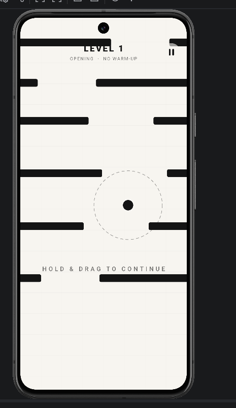

# Escape the Walls

**Hold. Drag. Escape.**

Escape the Walls is a fast, precision-based portrait arcade game for Android. Guide a ball through shifting walls, living machinery, gravity wells, lasers, rotating hazards, caves, and transforming geometric encounters.



## Gameplay

- Hold and drag to control the ball.
- Read each machine before it transforms.
- Dodge dynamic walls, rotors, lasers, black holes, and collapsing spaces.
- Use power-ups such as Shield, Freeze, Ghost, Blast, Blink, and Slow Time.
- Survive 56 increasingly difficult campaign levels.

## Features

- Fast one-touch arcade controls
- Authored campaign encounters
- Transforming obstacles and compound machines
- Multiple power-ups with distinct tactical uses
- Minimal black-and-white visual style
- Offline single-player gameplay

## Technology

- Kotlin
- Android SDK
- Jetpack Compose for menus and interface screens
- `SurfaceView` and Android `Canvas` for the gameplay loop
- Gradle

## Build

Open the project in Android Studio, or build a debug APK from the command line:

```bash
./gradlew assembleDebug
```

Create the Google Play release bundle with:

```bash
./gradlew bundleRelease
```

## Privacy

Read the [Escape the Walls Privacy Policy](https://AnIntellectualBeing.github.io/Escape-The-Walls/privacy_policy.html).

## Contact

For support or privacy questions, contact [anintellectualcompany.contact@gmail.com](mailto:anintellectualcompany.contact@gmail.com).

© 2026 An Intellectual Company. All rights reserved.
